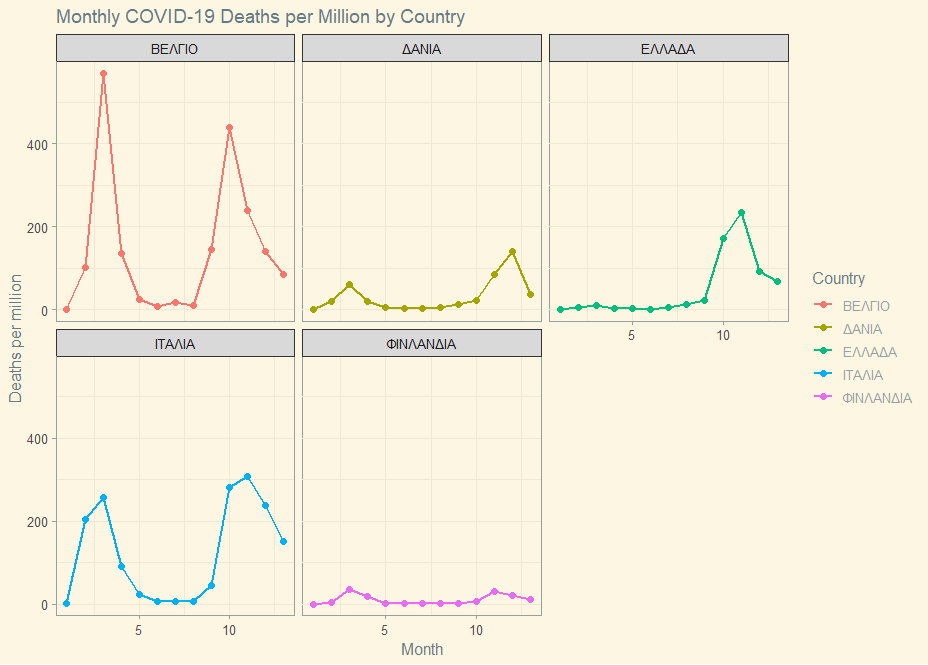

# COVID-19 Pandemic Trends

## Overview

This analysis examines the evolution of reported COVID-19 cases and deaths across five European countries: **Italy, Greece, Belgium, Denmark, and Finland**.

The objective is to explore how the pandemic developed across these countries, identify differences in reported cases and deaths over time, and support cross-country comparisons using population-adjusted indicators.

The analysis forms part of an undergraduate academic project in Statistics and Insurance Science at the University of Piraeus, Greece.

## Dataset Description

The analysis uses monthly COVID-19 observations covering 13 consecutive reporting periods for each of the five countries.

The dataset contains **65 observations and 7 variables**, including:

| Variable | Description |
|---|---|
| Country | Country associated with each observation |
| Month | Sequential reporting period (1–13) |
| Cases | Reported COVID-19 cases during the period |
| Cumulative Cases | Total reported cases up to the corresponding period |
| Deaths | Reported COVID-19 deaths during the period |
| Cumulative Deaths | Total reported deaths up to the corresponding period |
| Deaths / Cases | Ratio of reported deaths to reported cases within the period |

Two datasets are included:

- `data/All_countries.csv` - original monthly counts and cumulative totals.
- `data/All_countries by million.csv` - population-adjusted cases and deaths per million inhabitants.

Population-adjusted indicators help account for differences in population size when comparing countries.

## Methodology

The analysis was conducted using **R**, primarily with `ggplot2`, `dplyr`, and `ggthemes`.

The workflow includes:

1. Importing and organizing monthly COVID-19 observations.
2. Examining reported cases and deaths across the five countries.
3. Using cumulative totals to describe the progression of the pandemic.
4. Comparing population-adjusted indicators across countries.
5. Creating time-series visualizations to examine differences in pandemic trends.

The visualizations are descriptive and do not establish causal relationships.

## Monthly COVID-19 Cases by Country

The figure below compares monthly reported COVID-19 cases across Italy, Greece, Belgium, Denmark, and Finland.


The visualization highlights substantial differences in the timing and magnitude of reported cases. Italy displays particularly pronounced increases during the later reporting periods, while the other countries exhibit different trajectories.

All panels use a common vertical scale, allowing direct comparison of absolute case counts. However, differences in population size should be considered when interpreting these comparisons.

## Monthly COVID-19 Deaths per Million by Country

The following visualization presents monthly reported COVID-19 deaths per million inhabitants across Belgium, Denmark, Greece, Italy, and Finland.



The results reveal substantial differences in mortality trends across the five countries. Belgium exhibits the highest monthly peaks, while Italy also experiences pronounced increases during multiple periods. Greece and Denmark show notable increases in later periods, whereas Finland maintains comparatively lower reported mortality throughout the observed period.

Unlike absolute death counts, deaths per million inhabitants account for differences in population size, providing a more meaningful basis for cross-country comparisons.

**Analysis:** `scripts/COVID19_Deaths_Per_Million.R`

**Data:** `data/All_countries by million.csv`

## Tools and Technologies

- **R** - statistical analysis and data processing
- **ggplot2** - data visualization
- **dplyr** - data manipulation
- **ggthemes** - visualization themes
- **CSV** - structured data storage

## Project Structure

```text
01-pandemic-trends/
├── README.md
├── data/
│   ├── All_countries.csv
│   └── All_countries by million.csv
├── scripts/
│   ├── COVID19_Country_Comparison.R
│   └── COVID19_Deaths_Per_Million.R
└── figures/
    ├── monthly_cases_by_country.png
    └── deaths_per_million.png
```

## Reproducing the Visualizations

To reproduce the analyses:

1. Install R and the required packages: `ggplot2`, `dplyr`, and `ggthemes`.
2. Download the datasets and R scripts from this directory.
3. Set the R working directory to `01-pandemic-trends`.
4. Run the scripts:
   - `scripts/COVID19_Country_Comparison.R` for monthly reported cases.
   - `scripts/COVID19_Deaths_Per_Million.R` for monthly deaths per million inhabitants.

The CSV files use semicolons as separators, commas as decimal marks, and Windows Greek character encoding (`CP1253`).

**Note:** Both scripts should reference their input files through the `data/` directory. If a script still uses a local path from the original project, update that path before running it from the repository.
## Limitations

- The analysis is based on historical reported COVID-19 data.
- Differences in testing, reporting practices, and population size can affect comparisons between countries.
- Absolute counts are not directly comparable measures of population-level risk.
- The monthly death-to-case ratio is a descriptive measure and should not be interpreted as an individual probability of death.
- The analysis describes associations and temporal patterns rather than causal effects.
