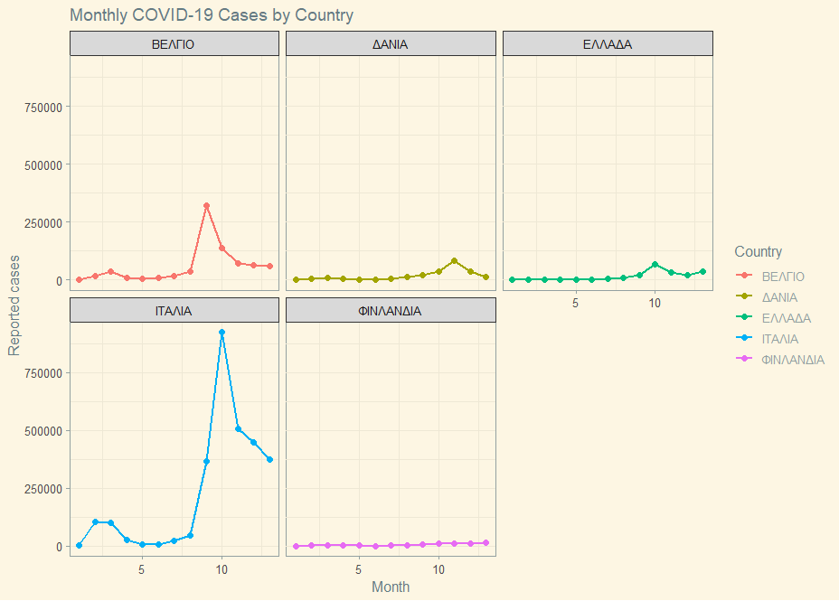

# COVID-19 Pandemic Trends

Monthly COVID-19 cases and deaths across five European countries: Italy, Greece, Belgium, Denmark, and Finland.

## Monthly COVID-19 Cases by Country

The figure below shows monthly reported COVID-19 cases in Italy, Greece, Belgium, Denmark, and Finland.

