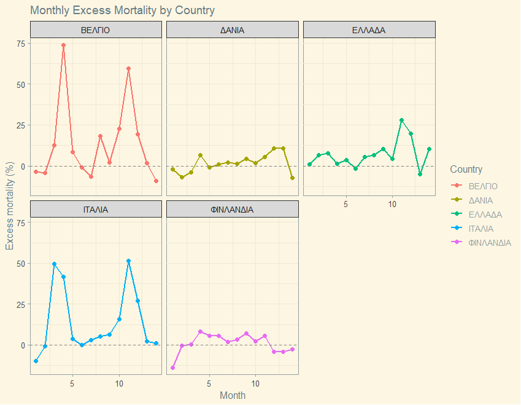

# COVID-19 Excess Mortality Analysis

## Overview

This project examines excess mortality during the COVID-19 pandemic across five European countries: **Belgium, Denmark, Greece, Italy, and Finland**.

The analysis is part of a larger university research project conducted at the University of Piraeus in 2021, investigating the impact of the pandemic on mortality patterns.

Unlike reported COVID-19 deaths, excess mortality captures changes in deaths from all causes relative to an expected historical baseline. This provides a broader perspective on mortality during the pandemic.

## Research Objectives

- Compare monthly excess mortality across five European countries.
- Identify periods of unusually high or low mortality.
- Examine differences in mortality patterns during the first and second pandemic waves.
- Visualize cross-country differences using R.

## Dataset

The dataset contains monthly excess mortality observations from **January 2020 to February 2021**.

| Property | Description |
|---|---|
| Countries | Belgium, Denmark, Greece, Italy, Finland |
| Period | January 2020 – February 2021 |
| Observations | 70 (14 months × 5 countries) |
| Main metric | Excess mortality (%) |
| Data format | CSV |
| Analysis software | R |

The dataset includes three variables:

- `ΧΩΡΑ` - Country
- `ΜΗΝΕΣ` - Month index
- `ΥΠΕΡΒΑΛΟΥΣΑ.ΘΝΗΣΙΜΟΤΗΤΑ` - Excess mortality percentage

## Methodology

### Excess Mortality

Excess mortality measures the difference between observed deaths and the number of deaths expected under normal conditions.

The percentage measure is expressed as:

\[
\text{Excess Mortality (\%)} =
\frac{\text{Observed Deaths} - \text{Expected Deaths}}
{\text{Expected Deaths}} \times 100
\]

The original research uses the corresponding mortality figures from **2015–2019** to establish the historical reference.

A positive percentage indicates mortality above the expected level, while a negative percentage indicates mortality below it.

Excess mortality should not be interpreted as the number of deaths directly caused by COVID-19, since it includes deaths from all causes.

### Data Visualization

The analysis uses R and the following packages:

- `ggplot2` - Data visualization
- `dplyr` - Data manipulation and plotting workflow
- `ggthemes` - Plot styling

Monthly excess mortality is visualized separately for each country using faceted line charts, allowing direct comparison of mortality patterns.

A dashed horizontal line at 0% indicates the historical reference level.

## Results and Visualization

### Monthly Excess Mortality by Country



*Reproduction of Figure 2.31 from the original university research project, with English labels and an additional zero-reference line.*

### Key Observations

**Belgium** experienced some of the largest excess mortality increases among the five countries, with pronounced peaks during the pandemic.

**Italy** recorded a substantial increase during the initial pandemic wave, followed by another period of elevated mortality.

**Greece** experienced a comparatively smaller initial impact, with a more pronounced increase during the later months of 2020.

**Denmark and Finland** generally maintained lower excess mortality levels than the other countries examined.

These findings highlight substantial differences in mortality patterns across European countries during the same pandemic period.

## Repository Structure

```text
02-excess-mortality/
├── README.md
├── data/
│   ├── README.md
│   └── Excess Mortality all countries.csv
├── scripts/
│   ├── README.md
│   └── COVID19_Excess_Mortality.R
└── figures/
    ├── README.md
    └── excess_mortality_by_country.png
```

## Reproducibility

To reproduce the visualization:

1. Install R and the required packages: `ggplot2`, `dplyr`, and `ggthemes`.
2. Download the `02-excess-mortality` directory.
3. Set the R working directory to `02-excess-mortality`.
4. Run `scripts/COVID19_Excess_Mortality.R`.

The script reads the CSV file from the `data/` directory using semicolon-separated values, decimal commas, and CP1253 character encoding.

## Limitations

- The analysis covers five European countries rather than the entire European region.
- The observation period ends in February 2021 and does not represent subsequent pandemic developments.
- Excess mortality reflects all-cause mortality and cannot independently establish the cause of individual deaths.
- Cross-country differences may reflect demographic, healthcare, reporting, and other contextual factors.

## Academic Context

**Institution:** University of Piraeus, Greece  
**Course:** Special Topics in Actuarial Science  
**Year:** 2021

This analysis reproduces part of the original research project, *The Effect of the Pandemic on Mortality for the Present and the Future*, with an emphasis on reproducible R code and clear data visualization.
