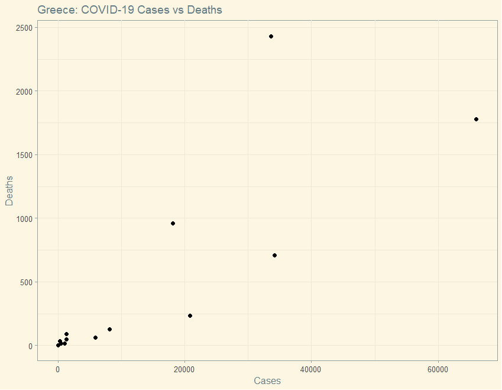
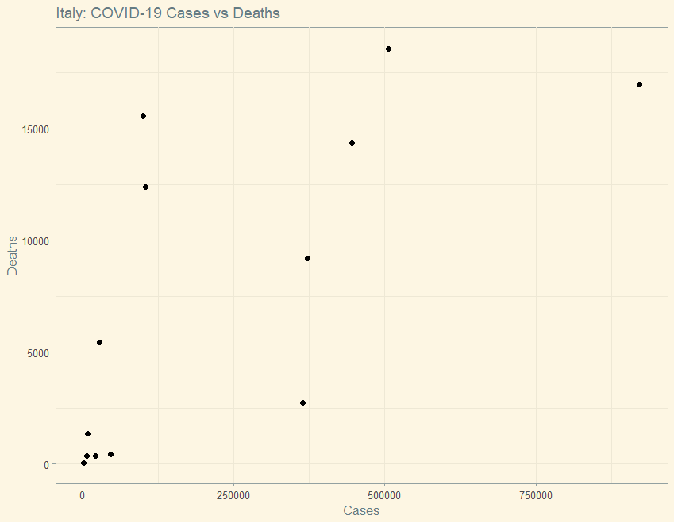
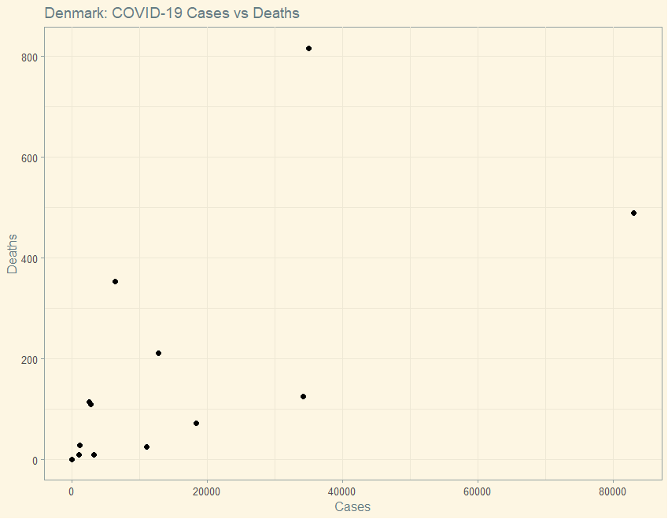
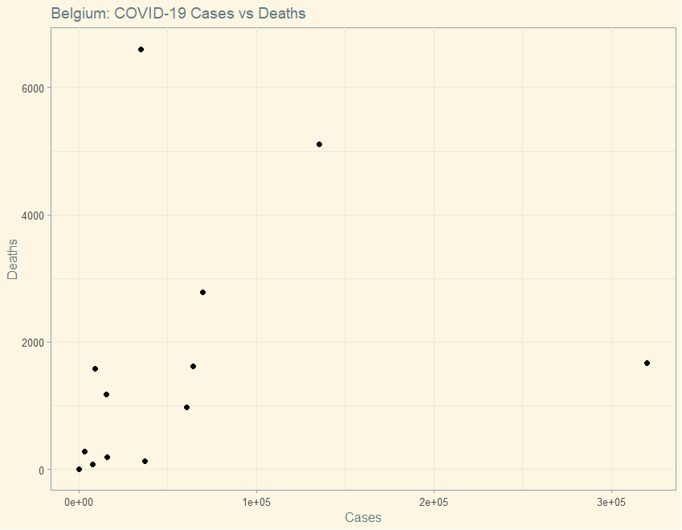
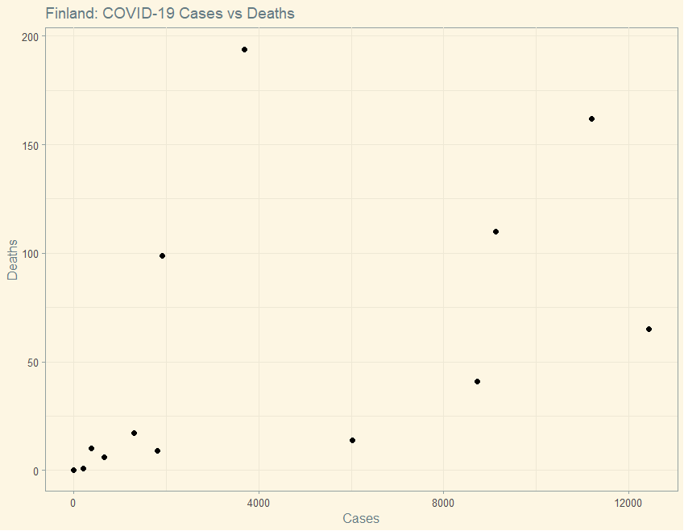

# COVID-19 Correlation Analysis

## Overview

This project explores the relationship between monthly COVID-19 cases and reported deaths across five European countries: **Greece, Italy, Denmark, Belgium, and Finland**.

The analysis was developed as part of a university group project at the **University of Piraeus (2021)**, investigating the impact of the COVID-19 pandemic on mortality.

This repository section focuses on reproducing the country-specific correlation analysis presented in **Section 4.4 (Figures 4.21–4.25)** and **Table 4.3** of the original report.

## Research Objective

The main objective is to investigate whether months with higher reported COVID-19 cases were also associated with higher numbers of reported deaths.

The analysis addresses two questions:

- How strongly are monthly COVID-19 cases and deaths correlated within each country?
- How does the strength of this relationship differ across the five countries?

## Dataset

The analysis uses monthly COVID-19 observations from five European countries.

| Dataset characteristic | Description |
|---|---|
| Countries | Greece, Italy, Denmark, Belgium, Finland |
| Observations | 65 |
| Period | 13 months per country |
| Main variables | Monthly cases and monthly deaths |
| Data format | CSV |
| Programming language | R |

The original dataset is available at [`data/All_countries.csv`](data/All_countries.csv).

## Methodology

### Spearman Rank Correlation

The **Spearman rank correlation coefficient (ρ)** was used to measure the strength and direction of the monotonic relationship between monthly COVID-19 cases and deaths.

Spearman correlation ranges from -1 to +1:

- **+1:** Perfect positive monotonic relationship.
- **0:** No monotonic correlation.
- **-1:** Perfect negative monotonic relationship.

Correlations were calculated separately for each country using R's `cor()` function with `method = "spearman"`.

### Exploratory Visualization

Five country-specific scatter plots were generated using `ggplot2` and `ggthemes`.

Each plot displays:

- **X-axis:** Monthly reported COVID-19 cases.
- **Y-axis:** Monthly reported COVID-19 deaths.
- **Points:** Monthly observations for the selected country.

The plots reproduce the country-specific analyses from the original university report, using English labels.

## Results

### Spearman Correlation by Country

The following coefficients were reported in Table 4.3 of the original analysis:

| Country | Spearman ρ | Interpretation in original report |
|---|---:|---|
| Greece | 0.923 | Very strong |
| Italy | 0.862 | Very strong |
| Denmark | 0.748 | Strong |
| Belgium | 0.686 | Moderate |
| Finland | 0.791 | Strong |

**Key findings:**

- **Greece** exhibited the strongest positive correlation between monthly cases and deaths.
- **Italy** also demonstrated a very strong positive relationship.
- **Finland and Denmark** showed strong positive correlations.
- **Belgium** had the lowest correlation coefficient among the five countries.

The results indicate positive associations between reported monthly cases and deaths across all five countries, although the strength of these relationships varies.

Minor differences in the final decimal places may occur when recalculating coefficients from the CSV.

## Visualizations

### Greece - Figure 4.21



### Italy - Figure 4.22



### Denmark - Figure 4.23



### Belgium - Figure 4.24



### Finland - Figure 4.25



## Technologies Used

- **R** - Data analysis and statistical computing
- **dplyr** - Data manipulation and grouping
- **ggplot2** - Scatter plot visualization
- **ggthemes** - Plot styling
- **Spearman correlation** - Statistical association analysis

## Repository Structure

```text
03-correlation-analysis/
├── README.md
├── data/
│   ├── README.md
│   └── All_countries.csv
├── scripts/
│   ├── README.md
│   └── COVID19_Correlation_Analysis.R
└── figures/
    ├── README.md
    ├── greece_cases_vs_deaths.png
    ├── italy_cases_vs_deaths.png
    ├── denmark_cases_vs_deaths.png
    ├── belgium_cases_vs_deaths.png
    └── finland_cases_vs_deaths.png
```

## Reproducibility

To reproduce the analysis:

1. Download or clone the repository.
2. Open R or RStudio.
3. Install the required packages:

```r
install.packages(c("dplyr", "ggplot2", "ggthemes"))
```

4. Set the working directory to `03-correlation-analysis`.
5. Run the script:

```r
source("scripts/COVID19_Correlation_Analysis.R")
```

The script loads the CSV dataset, calculates country-specific Spearman correlations, and generates the five scatter plots.

## Limitations

Several limitations should be considered when interpreting the results:

- The dataset contains only 13 monthly observations per country.
- Correlation does not establish causation.
- Reported cases depend on testing practices and reporting procedures.
- Deaths may occur weeks after infection, whereas this analysis compares observations from the same month.
- Other factors, including population characteristics, healthcare conditions, and pandemic interventions, are not explicitly controlled for.

Therefore, the results should be interpreted as descriptive statistical associations rather than causal estimates.

## Academic Context

This analysis is based on a **2021 University of Piraeus group project** examining the impact of COVID-19 on mortality.

The present GitHub section organizes and reproduces the original cases-versus-deaths correlation analysis in a more accessible and reproducible format, with English documentation and R scripts.
