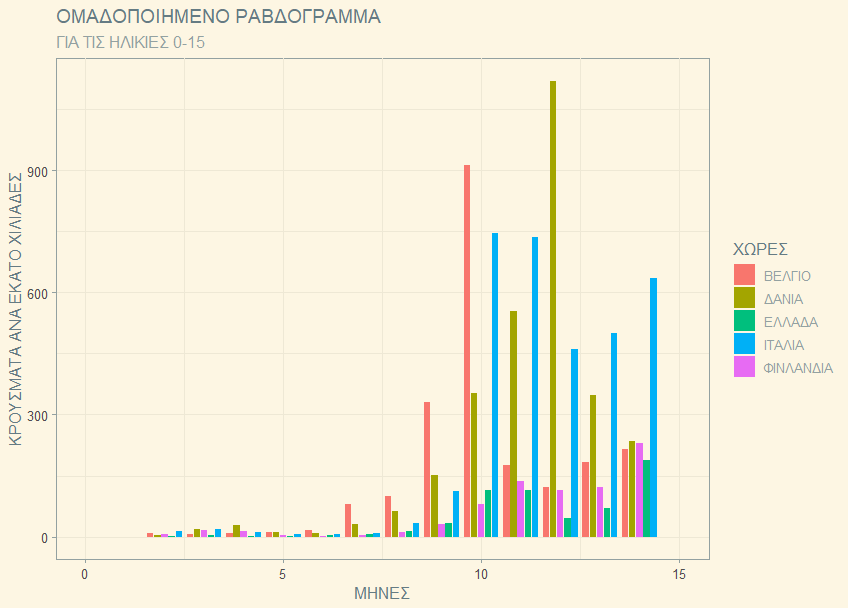
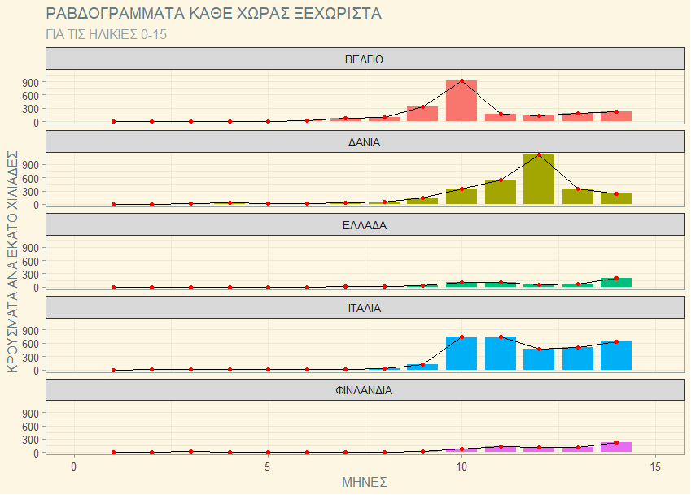
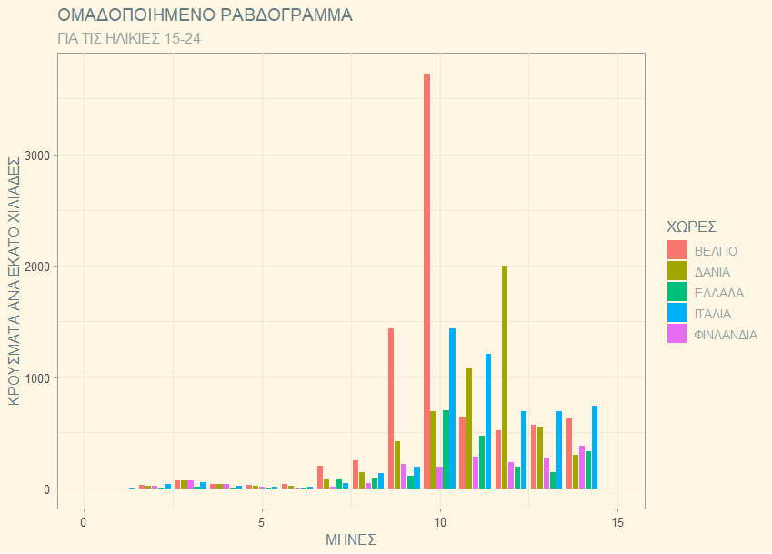
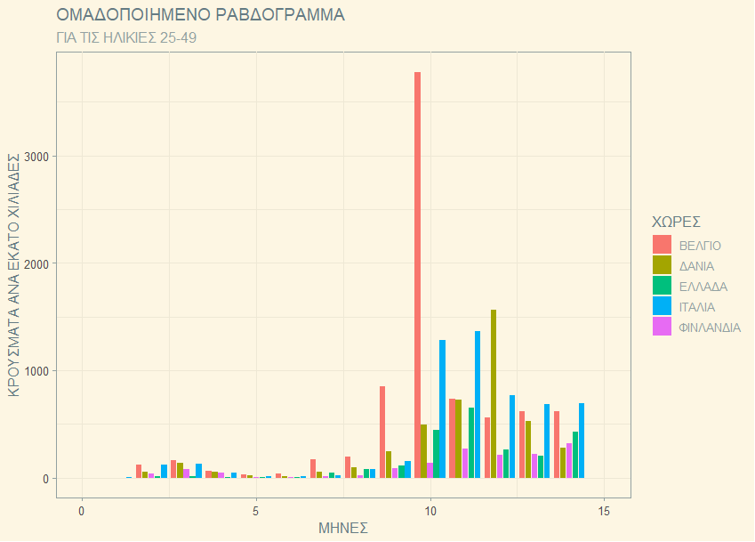
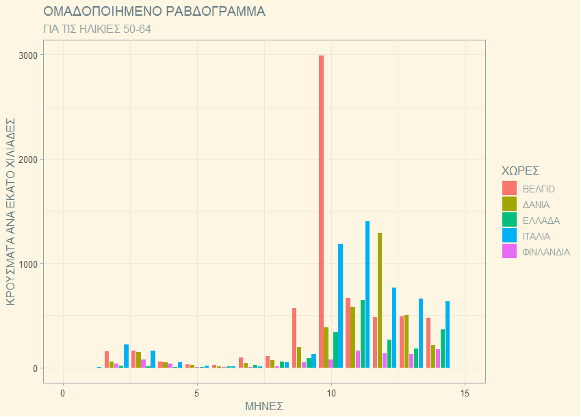
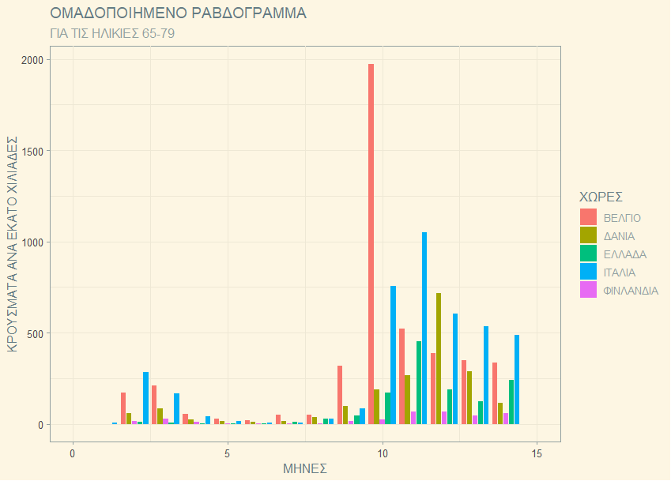
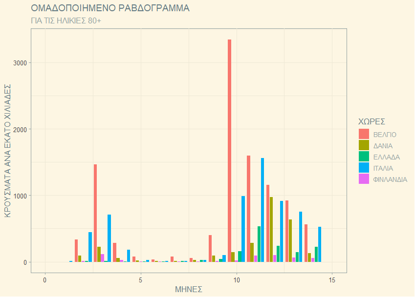

# Nonparametric Statistical Analysis of COVID-19 Cases

## Overview

This section presents the nonparametric statistical analysis conducted in Chapter 3 of my bachelor's thesis, *The Effect of the Pandemic on Mortality for the Present and the Future*, completed at the University of Piraeus in 2021.

The analysis investigates differences in reported COVID-19 cases across **five European countries** and **six age groups**, using normality tests, nonparametric hypothesis testing, and comparative visualizations.

The main objectives were to:

- Assess whether COVID-19 case distributions followed a normal distribution.
- Investigate differences between age groups within each country.
- Examine differences between countries within the same age group.
- Visualize the development of COVID-19 cases over time using population-adjusted measures.

## 1. Dataset and Study Design

The analysis covers five European countries:

**Belgium, Denmark, Finland, Greece, and Italy.**

COVID-19 case observations were collected on a weekly basis, from the fifth week of 2020 through the eighth week of 2021.

The observations were divided into six age groups:

| Age group | Description |
|---|---|
| 0–15 | Children |
| 15–24 | Adolescents and young adults |
| 25–49 | Adults |
| 50–64 | Middle-aged adults |
| 65–79 | Older adults |
| 80+ | Elderly population |

Data preparation and aggregation were performed using Microsoft Excel and R.

Population-adjusted COVID-19 case rates were used where appropriate to support comparisons between countries with different population sizes.

## 2. Statistical Methodology

### 2.1 Shapiro–Wilk Normality Test by Country

The Shapiro–Wilk test was applied separately to the six age groups within each country.

The hypotheses were:

- **H₀:** The observations follow a normal distribution.
- **H₁:** The observations do not follow a normal distribution.

The thesis reports statistically significant results across all examined country–age-group combinations, leading to rejection of the normality assumption at the 5% significance level.

This motivated the use of nonparametric statistical methods in subsequent analyses.

**Original statistical outputs:**

| Country | Shapiro–Wilk results |
|---|---|
| Belgium | See Table 3.1 of the thesis |
| Denmark | [View results](figures/shapiro_denmark.png) |
| Finland | [View results](figures/shapiro_finland.png) |
| Greece | [View results](figures/shapiro_greece.png) |
| Italy | [View results](figures/shapiro_italy.png) |

The Belgian results are referenced through the thesis rather than an additional screenshot because a discrepancy was identified between a reproduced statistic and Table 3.1.

### 2.2 Kruskal–Wallis Test by Country

Following the normality assessment, the Kruskal–Wallis test was used to compare the distributions of COVID-19 cases across the six age groups within each country.

The hypotheses were:

- **H₀:** The age groups have the same underlying distribution.
- **H₁:** At least one age group differs in distribution.

According to Tables 3.6–3.10 of the thesis, all five countries produced p-values below 0.05.

Therefore, the null hypothesis was rejected for every country, indicating statistically significant differences between age groups.

| Country | Kruskal–Wallis results |
|---|---|
| Belgium | [View results](figures/kruskal_belgium.png) |
| Denmark | [View results](figures/kruskal_denmark.png) |
| Finland | [View results](figures/kruskal_finland.png) |
| Greece | [View results](figures/kruskal_greece.png) |
| Italy | [View results](figures/kruskal_italy.png) |

### 2.3 Shapiro–Wilk Normality Test by Age Group

The analysis was then reversed to investigate each age group across the five countries.

To account for differences in country population sizes, the thesis used reported COVID-19 cases per million inhabitants for these statistical comparisons.

The Shapiro–Wilk test was performed separately for each country within each age group.

According to Tables 3.11–3.16, all reported p-values were below 0.05, indicating departures from normality.

| Age group | Shapiro–Wilk results |
|---|---|
| 0–15 | [View results](figures/shapiro_age_0-15.png) |
| 15–24 | [View results](figures/shapiro_age_15-24.png) |
| 25–49 | [View results](figures/shapiro_age_25-49.png) |
| 50–64 | [View results](figures/shapiro_age_50-64.png) |
| 65–79 | [View results](figures/shapiro_age_65-79.png) |
| 80+ | [View results](figures/shapiro_age_80plus.png) |

### 2.4 Kruskal–Wallis Test by Age Group

The Kruskal–Wallis test was subsequently used to compare COVID-19 case distributions between countries for each age group.

The hypotheses were:

- **H₀:** The countries have the same underlying case distribution within the selected age group.
- **H₁:** At least one country differs in distribution.

According to Tables 3.17–3.22, the null hypothesis was rejected for all six age groups.

These findings indicate that COVID-19 case distributions differed significantly between countries across the examined age categories.

| Age group | Kruskal–Wallis results |
|---|---|
| 0–15 | [View results](figures/kruskal_age_0-15.png) |
| 15–24 | [View results](figures/kruskal_age_15-24.png) |
| 25–49 | [View results](figures/kruskal_age_25-49.png) |
| 50–64 | [View results](figures/kruskal_age_50-64.png) |
| 65–79 | [View results](figures/kruskal_age_65-79.png) |
| 80+ | [View results](figures/kruskal_age_80plus.png) |

**Interpretation note:** A significant Kruskal–Wallis result indicates an overall difference among groups. It does not, by itself, identify which specific pairs of groups differ.

## 3. COVID-19 Cases by Age Group and Country

The final part of Chapter 3 presents comparative bar charts of COVID-19 cases across countries and age groups.

Unlike the weekly observations used in the statistical analyses, these visualizations use **monthly aggregated cases per 100,000 inhabitants**, covering January 2020 through February 2021.

For each age group, two figures are provided:

1. A grouped bar chart comparing all five countries.
2. A set of country-specific bar charts with line and point overlays illustrating monthly changes.

The charts use consistent country colors and a Solarized visual theme.

### Age group 0–15





The thesis describes generally lower case rates in this age group, with notable increases in Belgium and Denmark during different periods and comparatively lower rates in Greece and Finland.

### Age group 15–24



[View country-specific charts](figures/age_15-24_by_country.png)

### Age group 25–49



[View country-specific charts](figures/age_25-49_by_country.png)

### Age group 50–64



[View country-specific charts](figures/age_50-64_by_country.png)

### Age group 65–79



[View country-specific charts](figures/age_65-79_by_country.png)

### Age group 80+



[View country-specific charts](figures/age_80plus_by_country.png)

## 4. Key Findings

The statistical analyses reported in Chapter 3 support three main findings:

**Non-normal case distributions.** The Shapiro–Wilk tests rejected the assumption of normality across the examined countries and age groups.

**Significant differences between age groups.** The Kruskal–Wallis tests identified statistically significant differences in case distributions across age groups within each country.

**Significant differences between countries.** Population-adjusted comparisons also identified statistically significant differences between countries within each age group.

The monthly visualizations provide additional descriptive context, showing how the timing and magnitude of reported COVID-19 cases varied geographically and demographically.

These findings describe differences in reported case distributions; they do not establish causal explanations for those differences.

## 5. Repository Contents

```text
03-nonparametric-statistical-analysis/
│
├── README.md
│
├── data/
│   ├── README.md
│   ├── 0-15.csv
│   ├── 15-24.csv
│   ├── 25-49.csv
│   ├── 50-64.csv
│   ├── 65-79.csv
│   └── 80+.csv
│
├── scripts/
│   ├── README.md
│   └── age_group_bar_charts.R
│
└── figures/
    ├── README.md
    ├── age_*_grouped_bar_chart.png
    ├── age_*_by_country.png
    ├── shapiro_*.png
    └── kruskal_*.png
```

The six CSV files contain the monthly population-adjusted data used for the visualizations. The `figures/` directory contains the 12 recreated charts and archived RStudio statistical-test outputs.

## 6. Reproducibility

The script [`age_group_bar_charts.R`](scripts/age_group_bar_charts.R) is intended to generate the 12 monthly COVID-19 visualizations from the six CSV files.

**Requirements:**

- R
- `ggplot2`
- `ggthemes`

Install the required packages:

```r
install.packages(c("ggplot2", "ggthemes"))
```

Run the script from the `COVID-19-Mortality-Analysis` project root:

```r
source("03-nonparametric-statistical-analysis/scripts/age_group_bar_charts.R")
```

The script expects the six CSV files to be located in `03-nonparametric-statistical-analysis/data/` and saves its output to `03-nonparametric-statistical-analysis/figures/`.

**Reproducibility status:** The visualizations were recreated individually in RStudio. The consolidated script has been prepared but has not yet completed a successful end-to-end verification. The Shapiro–Wilk and Kruskal–Wallis screenshots are archived statistical outputs; a complete standalone reproduction pipeline for these tests is not included.

## 7. Academic Context

This analysis forms part of the bachelor's thesis:

*The Effect of the Pandemic on Mortality for the Present and the Future*  
**University of Piraeus, 2021**

The repository presents selected data, statistical outputs, code, and visualizations from the original academic work as a structured data analysis portfolio project.
