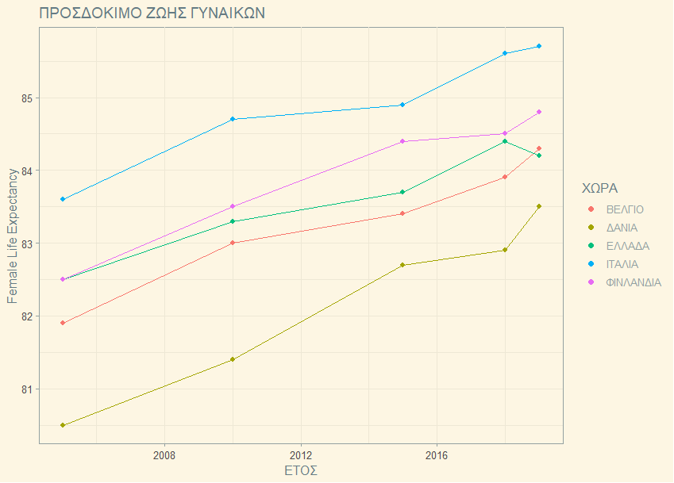
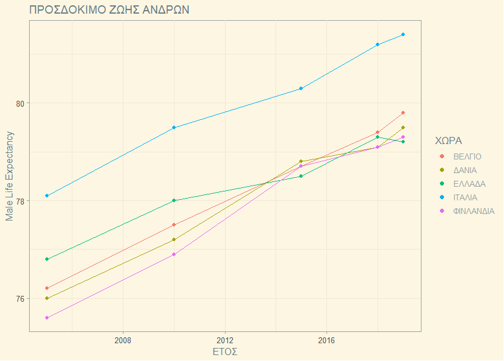
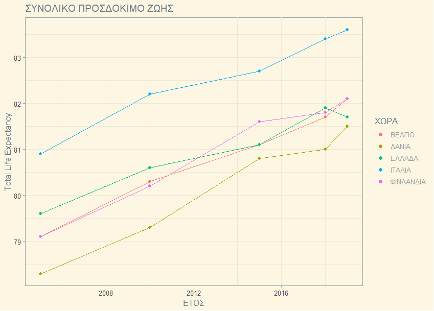

# Life Expectancy Analysis (2005-2020)

## Overview

This analysis examines pre-pandemic life expectancy trends across five European countries: Belgium, Denmark, Greece, Italy, and Finland.

Based on Chapter 5.1 of the original bachelor's project, *The Effect of the Pandemic on Mortality for the Present and the Future* (University of Piraeus, 2021), the analysis establishes a historical baseline for understanding life expectancy patterns before the COVID-19 pandemic.

The study compares female, male, and total life expectancy, highlighting differences between countries, gender gaps, and changes over time.

## Dataset

The dataset contains life expectancy at birth for five European countries across five reference years: **2005, 2010, 2015, 2018, and 2019**.

The values originate from Eurostat data reported in Table 5.1 of the original project.

| Variable | Description |
|---|---|
| Year | Reference year |
| Country | Belgium, Denmark, Greece, Italy, or Finland |
| Female | Female life expectancy at birth, in years |
| Male | Male life expectancy at birth, in years |
| Total | Overall life expectancy at birth, in years |

The dataset contains **25 country-year observations**, with separate life expectancy measurements for each population group.

## Methodology

The analysis was conducted using R, following the visualization approach presented in the original project.

The workflow includes:

1. Importing the life expectancy dataset from Excel.
2. Converting decimal-comma values into numeric measurements.
3. Organizing observations by country and reference year.
4. Generating three comparative line charts using `ggplot2` and `ggthemes`.
5. Examining differences in life expectancy across countries and between sexes.

The analysis is descriptive and focuses on observed historical patterns rather than statistical prediction or causal inference.

## Visualizations

### 1. Female Life Expectancy



Female life expectancy generally increased across the five countries during the study period. Greece displayed a noticeable increase to 84.4 years in 2018, followed by a slight decrease to 84.2 years in 2019.

### 2. Male Life Expectancy



Italy consistently recorded higher male life expectancy than the other countries. Greece showed relatively small fluctuations in the later reference years, while the remaining countries followed broadly similar upward patterns.

### 3. Total Life Expectancy



Overall life expectancy increased across the study period, although the countries maintained differences in their levels.

Italy remained the leading country, while Denmark generally recorded the lowest values. Differences between countries were less pronounced in the overall life expectancy comparison.

## Impact of COVID-19 on Life Expectancy (2020)

In addition to the historical analysis, the original project examined changes in life expectancy during the first year of the COVID-19 pandemic.

According to Eurostat, the following changes were observed between 2019 and 2020:

| Country | Change in Life Expectancy (Years) |
|---|---:|
| Belgium | -1.2 |
| Denmark | +0.1 |
| Finland | +0.1 |
| Greece | -0.5 |
| Italy | -1.2 |

Belgium and Italy experienced the largest declines among the five countries, while Greece recorded a smaller decrease. Denmark and Finland were the only two countries in this comparison to experience slight increases.

These findings provide additional context for the historical life expectancy trends examined in this project.

**Source:** Eurostat, *How did life expectancy change in 2020?* (Figure 5.4 of the original project).

**Note:** These pandemic-period values are sourced from Eurostat and are not generated by the R script included in this repository.

## Key Findings

**1. Life expectancy increased between 2005 and 2019.**

All five countries experienced an increase in total life expectancy between the first and last reference years.

**2. Women consistently had higher life expectancy than men.**

Female life expectancy exceeded male life expectancy across every country and reference year, reflecting a persistent gender gap.

**3. Italy recorded the highest overall life expectancy.**

Italy increased from 80.9 years in 2005 to 83.6 years in 2019, maintaining its leading position among the five countries.

**4. Greece experienced minor fluctuations toward the end of the period.**

Greek female life expectancy decreased from 84.4 years in 2018 to 84.2 years in 2019. Total life expectancy also decreased from 81.9 to 81.7 years.

**5. Denmark generally remained at the lower end of the comparison.**

Despite improvements over time, Denmark recorded the lowest total life expectancy among the selected countries throughout the reference years.

## Reproducibility

### Requirements

- R
- `readxl`
- `ggplot2`
- `ggthemes`

Install the required packages:

```r
install.packages(c("readxl", "ggplot2", "ggthemes"))
```

### Run the analysis

1. Download or clone the repository.
2. Set the R working directory to `06-life-expectancy-analysis`.
3. Run:

```r
source("scripts/COVID19_Life_Expectancy_Analysis.R")
```

The script reads the Excel dataset from the `data` directory and creates the three life expectancy visualizations.

## Project Structure

```text
06-life-expectancy-analysis/
├── README.md
├── data/
│   ├── README.md
│   └── Life_Expectancy_2005_2019.xlsx
├── scripts/
│   ├── README.md
│   └── COVID19_Life_Expectancy_Analysis.R
└── figures/
    ├── README.md
    ├── female_life_expectancy.png
    ├── male_life_expectancy.png
    └── total_life_expectancy.png
```

## Project Background and Sources

This analysis reproduces the pre-pandemic life expectancy comparison presented in **Chapter 5.1, Table 5.1, and Figures 5.1-5.3** of the original bachelor's project, completed at the University of Piraeus in 2021.

The original study used Eurostat life expectancy data to establish historical trends before examining the impact of COVID-19 on mortality and life expectancy.

**Scope:** The R visualizations in this section cover historical life expectancy trends from 2005 to 2019. Changes during 2020 are presented separately using published Eurostat figures, rather than estimates produced by the included R script.
