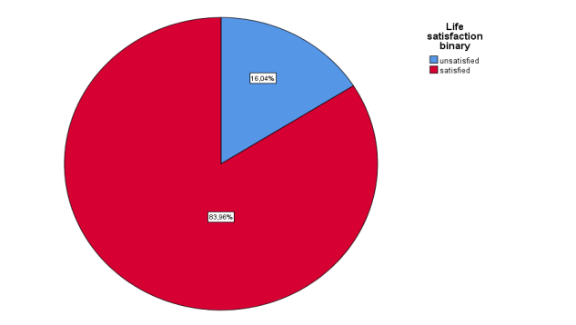
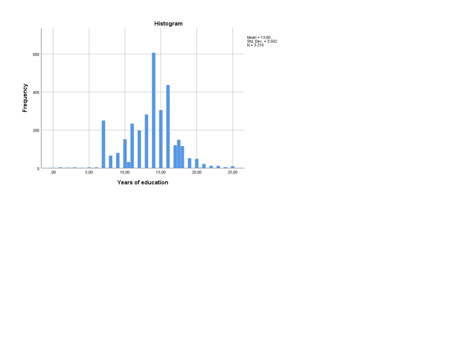
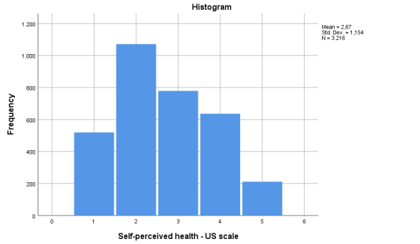
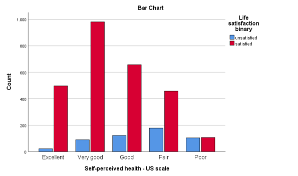

# Life Satisfaction Analysis in Denmark

**Undergraduate Statistics Project | University of Piraeus | 2021**

*Documentation revised in 2026.*

## Overview

This project investigates factors associated with life satisfaction among adults aged 50 and over in Denmark, using survey data from 2017.

The analysis explores how demographic, socioeconomic, and health-related characteristics relate to individuals' reported satisfaction with life.

The project was completed as part of the *Statistics of Social Phenomena* course at the University of Piraeus.

## Dataset

- **Country:** Denmark
- **Reference year:** 2017
- **Sample size:** 3,216 individuals
- **Age group:** 50 years and older
- **Data source:** Dataset provided for the university course
- **Target variable:** Binary life satisfaction (satisfied / unsatisfied)

The analysis examines five explanatory variables:

- Age
- Years of education
- Household ability to make ends meet
- Current employment status
- Self-perceived health

## Tools & Methods

**Software:** IBM SPSS Statistics

**Statistical techniques:**
- Descriptive statistics and frequency distributions
- Data visualization (histograms, bar charts, and pie charts)
- Cross-tabulation analysis
- Chi-square tests of independence
- Measures of association (Phi, Cramer's V, and correlation coefficients)
- Binary logistic regression

## Key Findings

- **84%** of respondents reported being satisfied with their lives, while **16%** reported being unsatisfied.
- Self-perceived health showed a statistically significant association with life satisfaction (Chi-square test, p < 0.001).
- The association between self-perceived health and life satisfaction had a Cramer's V of **0.325**.
- Household financial circumstances were also significantly associated with life satisfaction (p < 0.001).
- Age, education, and employment status were examined as additional factors associated with life satisfaction.

Overall, the findings highlight the relevance of health and financial circumstances in understanding reported life satisfaction within the sample.

## Visualizations

The following visualizations were produced using IBM SPSS Statistics as part of the original analysis.

### Life Satisfaction Distribution

**84%** of respondents reported being satisfied with their lives, compared with **16%** who reported being unsatisfied.

### Years of Education

The distribution of years of education among respondents, providing an overview of the sample's educational background.

### Self-Perceived Health

Respondents rated their health across five categories, ranging from excellent to poor. The most common response was "Very good."

### Health and Life Satisfaction

The visualization explores the relationship between self-perceived health and life satisfaction. Respondents reporting better health generally showed higher levels of life satisfaction.

## Project Report

The full academic report is written in Greek and includes descriptive statistics, visualizations, cross-tabulations, hypothesis tests, measures of association, and binary logistic regression results.

**Full report:** [View PDF](Denmark.pdf)

## Notes

This undergraduate academic project was originally completed in 2021. The written report was revised in 2026 to improve source attribution and documentation.

The original analysis was conducted using IBM SPSS Statistics. The dataset was provided for educational purposes and is not included in this repository.

The findings describe statistical associations and should not be interpreted as evidence of causation.
